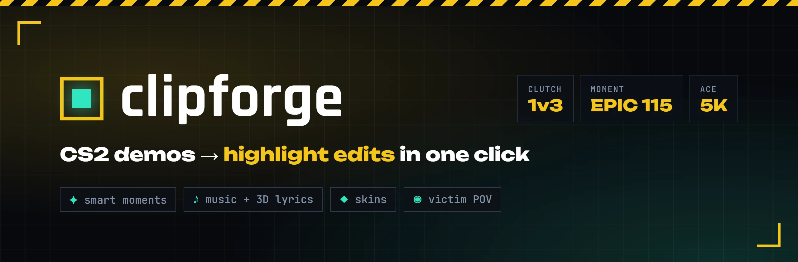
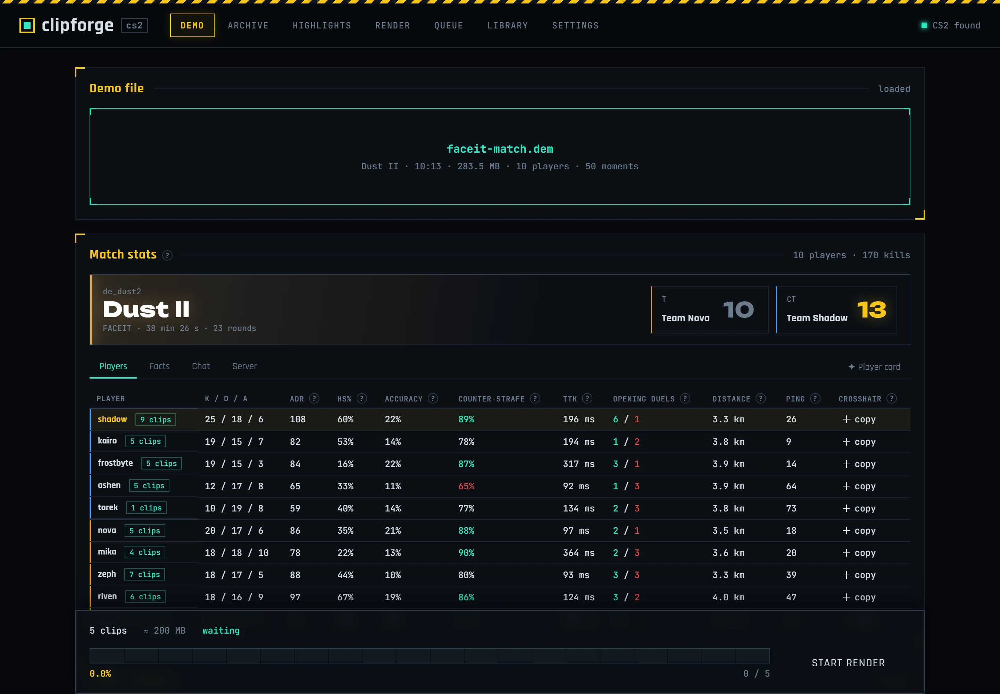
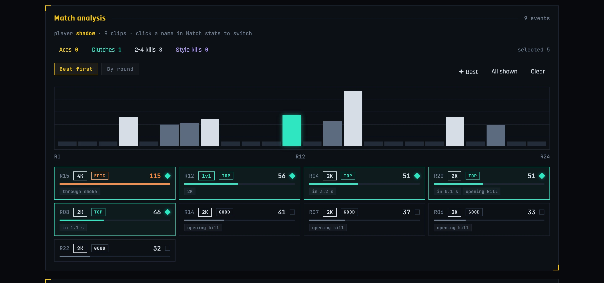
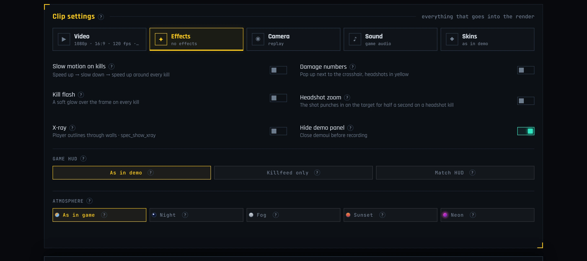
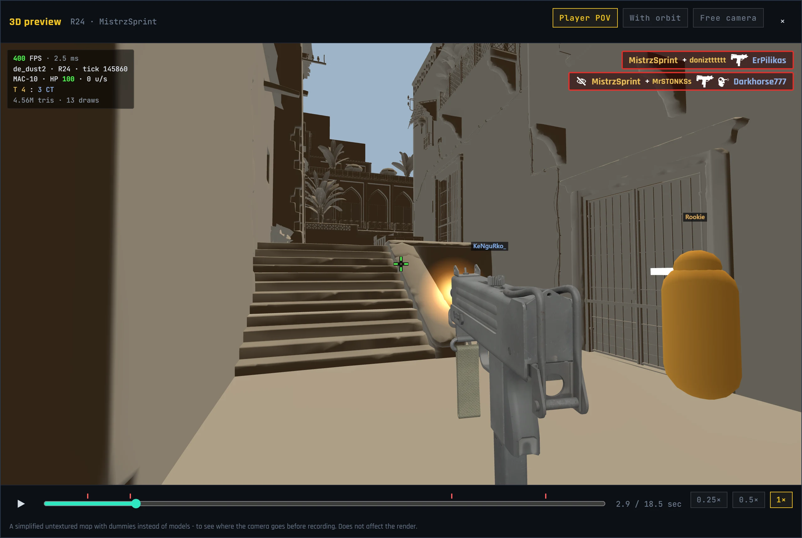
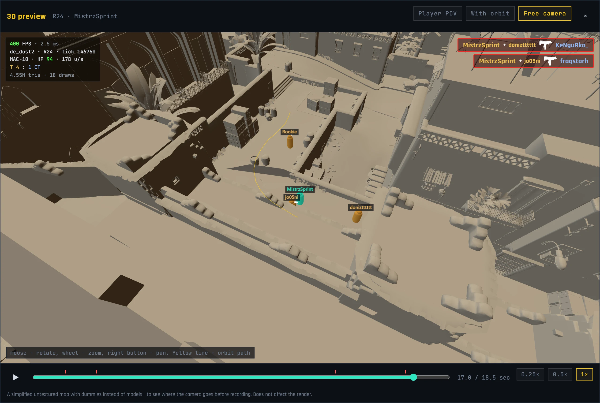
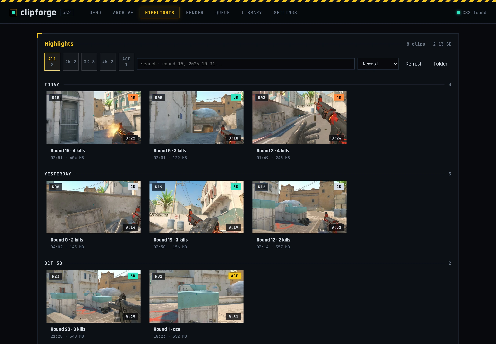
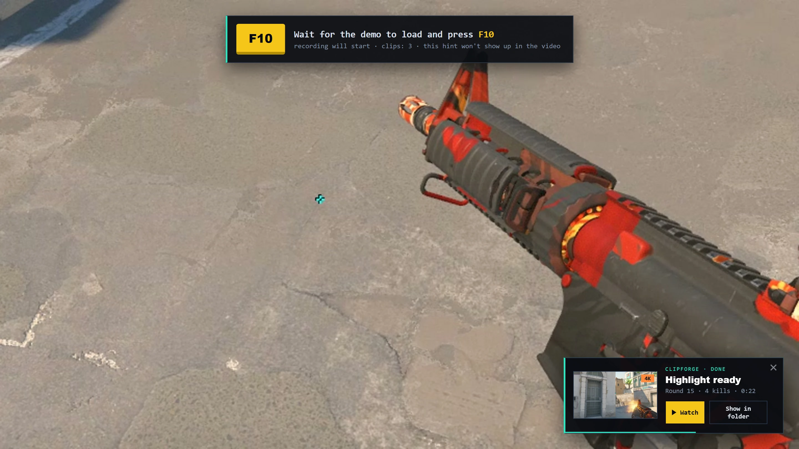
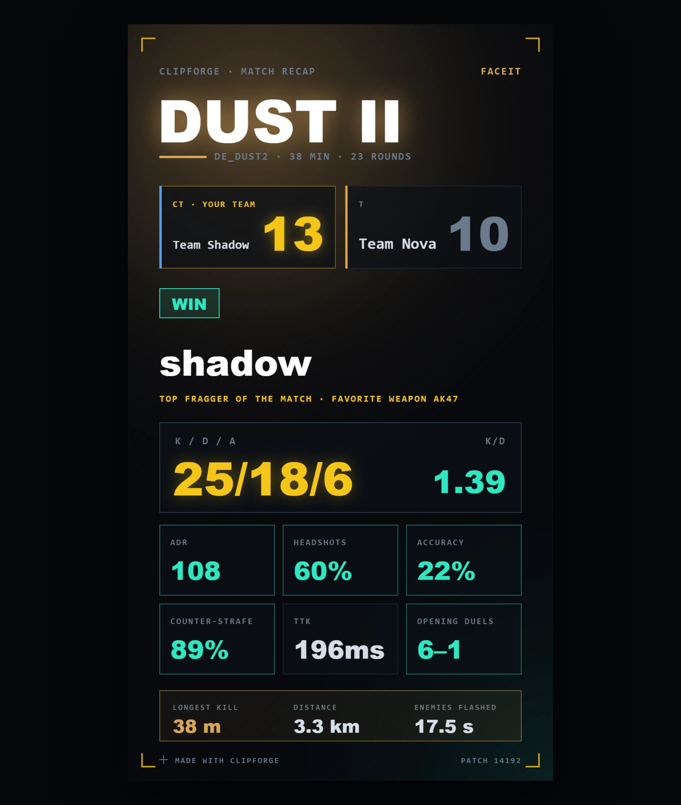
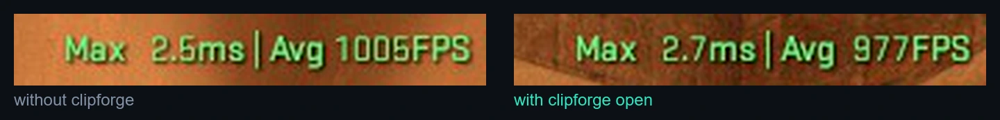

<div align="center">



**English** · [Русский](README.ru.md)

[](#requirements)
[](https://tauri.app)
[](https://react.dev)
[](https://www.rust-lang.org)
[](LICENSE)
[](https://github.com/BeanDx/clipforge/stargazers)

**Drop in a CS2 demo, get ready-to-post highlight edits.**<br>
clipforge finds your best moments, lets you preview them in 3D, records them in-game through HLAE and adds slow-mo, music with 3D lyrics, skins and a victim POV replay. No video editor needed.

</div>

<br>

<p align="center"></p>

## Features

### ✦ Smart moment picking
Every round of every player gets a score and tags, the way highlight services do it, but using everything the demo has.

- **Multi-kills** 2K, 3K, 4K, ACE, with a bonus for speed ("3K in 2.1 s")
- **Real clutches 1vN**: when you were the last one alive, against how many, and whether your team won the round
- **Style kills**: wallbangs, through smoke, no-scopes, jump shots, while blind, knife, zeus, 40+ m kills, collaterals
- **Context**: opening kills, eco rounds, pistol rounds, the deciding round, ninja defuses
- Tiers from **Good** to **Legendary**, sorted best first, picked automatically

<p align="center"></p>

### 🎬 Effects that look like an edit
- **Slow motion** around kills with smooth ramps, audio slowed with Rubber Band so gunshots stay crisp
- **Kill flash** (pink, white or gold glow) and **headshot zoom**
- **Beat-synced zoom and shake** from the track's kick and bass
- **Atmosphere**: Night, Fog, Sunset, Neon, as a color grade plus real in-game fog and sky through HLAE
- **Damage numbers** next to the crosshair, a full **match HUD** drawn from demo data, or a clean killfeed-only view
- **Graphics**: as in game, **Cinematic** (ReShade: soft corner shadows, bounce light, reflections, bloom, film color) or **Max quality** (records at twice the size and scales down: no jaggies, sharper textures; needs AMD VSR or NVIDIA DSR turned on once)
- **Cut the search between kills**: if you ran around the map for a while between kills of one moment, the middle is cut out
- Frame blending, any resolution and aspect ratio, **stretched 4:3** (including 1440×1080, exactly 1920×1080 after stretching), GPU encoding (NVENC, AMF, Quick Sync)

<p align="center"></p>

### ♪ Music and lyrics in the map
- Add your own track, synced lyrics are fetched from LRCLIB (or paste your own and mark the lines with Space)
- Lyrics float in 3D inside the map with a karaoke highlight
- The chorus lands exactly on your last kill, together with a smooth slow-mo

### ◉ Cinematic camera
- **Victim POV replay**: after the clip, every kill is replayed through the eyes of the player you killed, a moment past the death so you see them drop
- **Orbit camera** around the player after the final kill
- **Post-round reaction**: if the moment ended the round, the clip jumps to the next round's spawn, the camera circles the player and you hear the team react in voice chat

### 🧊 3D preview before recording
Press **3D** on any moment to watch it right in the app, before CS2 even starts.

- The real map geometry, exported from **your own CS2 install** (nothing from Valve ships with clipforge)
- All ten players as dummies in team colors, with names, crouching and deaths, straight from the demo
- **Player POV** with the real position and angles, a CS2-style crosshair and the **weapon in hand**: the model and textures come from the game and change when the player switches weapons
- **Shots you can see**: muzzle flash, tracers, recoil and crosshair kick, for everyone on the map
- A **killfeed** with the game's own icons: headshot, wallbang, through smoke, no-scope, blind, assists
- **With orbit** plays the exact `mirv_campath` that goes to HLAE, so you see where the orbit camera will fly. **Free camera** shows that path as a yellow line
- A timeline with kill marks, 0.25× / 0.5× / 1× speed and a compact info panel: FPS, tick, weapon, HP, speed, players alive

<p align="center"></p>

<p align="center"></p>

### ✂️ Edits and videos from several demos
- **Clips** or **Edit** mode on the Demo tab. Edit presets: **Night Edit** (a night intro with stars, a moon, glowing dust and lyrics, then the best kills, each on a beat) and **Cinematic**
- **One video from several demos**: pick moments in one demo, open another and pick there. Everything goes into one render, recorded in a single CS2 run

### ◆ Skins
Change weapon skins, the knife model and finish, and gloves. clipforge writes a modified copy of the demo, so nothing touches your inventory or the game files.

### 📊 Match stats and profile
- Things the scoreboard doesn't show: crosshair codes (one click to copy), accuracy, counter-strafing, time to kill, opening duels, distance run, chat and server settings. Optional FACEIT levels with your own API key
- **Profile**: Steam and FACEIT stats, form over the last 30 matches, maps, and what clipforge recorded while you played (hours, matches, weapons). Only matches on Valve servers and FACEIT count
- **Achievements** in bronze, silver and gold, **Steam friends**, and a side-by-side **comparison** of any two players

### 🖼 Highlights gallery, player card and more
- A gallery of finished clips with previews, sorting, filters and a built-in player
- A **1080×1920 player card** for stories or Discord, copied to the clipboard in one click
- **Before / after** slider: raw demo vs the finished clip, same moment
- A hint on top of CS2 shows which key starts recording and the live progress. It never ends up in the video
- A notification when your highlight is ready
- **First-run wizard**: finds CS2 in every Steam library, checks HLAE, the highlights folder and free space, and records a 5-second test clip
- **Auto-updates** with a "What's new" window
- A chicken lives at the bottom of the window. You can pet it, grab it and throw it, and it wears headphones while you render. It and its sounds can be turned off
- English and Russian interface, switched live

<table>
  <tr>
    <td width="50%"></td>
    <td width="50%"></td>
  </tr>
  <tr>
    <td align="center"><sub>Highlights gallery</sub></td>
    <td align="center"><sub>In-game hint and "highlight ready" notification</sub></td>
  </tr>
</table>

<p align="center"></p>

## How it works

```
 .dem ──► demoparser2 ──► moments + stats ──► you pick the clips
                                                    │
     3D preview? ──► map + weapons from your CS2 ◄──┤
                                                    │
        skins? ──► source2-demo rewrites a copy ◄───┘
                                                    │
 CS2 + HLAE plays the demo, you press F10 ──► raw frames + audio
                                                    │
 ffmpeg: blend, slow-mo, HUD, lyrics, flash, zoom, music ──► .mp4
```

1. The demo is parsed with **demoparser2**: kills, damage, positions, rounds, equipment.
2. Moments are scored and shown on a round timeline. For the 3D preview, **Source 2 Viewer** exports the map, weapon models and killfeed icons from your CS2 once and caches them, and **three.js** draws the scene.
3. If you changed skins, the demo copy is rewritten with **source2-demo**.
4. **CS2 launches through HLAE** with the demo. You can watch it first, recording starts when you press the hotkey (F10 by default).
5. HLAE records frames straight from the engine. **ffmpeg** then puts the clip together with all the effects.

## Requirements

**To use:**
- Windows 10 or 11
- [Counter-Strike 2](https://store.steampowered.com/app/730) installed through Steam
- [HLAE](https://www.advancedfx.org) (Half-Life Advanced Effects). Its ffmpeg is used for encoding, so nothing else is needed
- clipforge downloads the rest itself the first time it's needed: ReShade for the Cinematic look (~10 MB) and Source 2 Viewer CLI for the 3D preview (~53 MB)

**To build from source, also:**
- [Node.js](https://nodejs.org) 18 or newer
- [Rust](https://rustup.rs) stable and the Visual Studio C++ build tools
- WebView2 (already part of Windows 10/11)

## Getting started

**Installer:** download `clipforge_x.y.z_x64-setup.exe` from [Releases](https://github.com/BeanDx/clipforge/releases) and run it. Everything it needs is inside, including its own copy of Node.js for demo parsing. After that it updates by itself.

**From source:**

```bash
git clone https://github.com/BeanDx/clipforge.git
cd clipforge
npm install
npx tauri dev
```

Build an installer:

```bash
npx tauri build
```

The installer ends up in `src-tauri/target/release/bundle/`.

**First run:**
1. The setup wizard finds CS2 and HLAE, checks the highlights folder and can record a 5-second test. You can run it again from **Settings**.
2. Drop a `.dem` file on the **Demo** tab.
3. Pick a player in **Match stats**, choose moments, tweak **Clip settings**. Press **3D** on a moment to preview it.
4. Press **Start render**, wait for the demo to load in CS2 and press **F10**.
5. After pressing F10 you can alt-tab and do something else, recording keeps going. When it's done you get a notification and the clips land in **Highlights**.

## FAQ

<details>
<summary><b>Can I get VAC banned for this?</b></summary>
<br>
CS2 is started through HLAE with <code>-insecure</code>, which means VAC is off for that session and you can't join secured servers with it. clipforge only plays demos locally. Close the game afterwards (clipforge does it for you) and start CS2 normally before playing matchmaking.
</details>

<details>
<summary><b>Does it lower my FPS if I keep it open while playing?</b></summary>
<br>
Barely. Same spot on the map, the CS2 FPS counter, left with clipforge closed, right with it open:
<br><br>

<br>
1005 vs 977 average FPS, about 3%, which is within normal run-to-run variance. While the game is in focus, clipforge pauses all its animations and uses about 0% CPU and ~270 MB of RAM.
</details>

<details>
<summary><b>Do I need a FACEIT API key?</b></summary>
<br>
No. It's only used to show FACEIT levels and Elo in Match stats. Everything else works without it.
</details>

<details>
<summary><b>Are skin changes visible to anyone else?</b></summary>
<br>
No. clipforge writes a modified copy of the demo file and records from it. Your inventory, the game and the original demo stay untouched.
</details>

<details>
<summary><b>Does the 3D preview ship any game files?</b></summary>
<br>
No. The map, weapon models and icons are exported from the CS2 you have installed with the open-source Source 2 Viewer and cached in <code>%LOCALAPPDATA%\clipforge</code>. After a map update in CS2 the map is exported again. Workshop maps aren't supported.
</details>

<details>
<summary><b>Which demos work?</b></summary>
<br>
CS2 demos from FACEIT, Valve matchmaking and Premier, and SourceTV demos from community servers.
</details>

## Built with

| | |
|---|---|
| [Tauri 2](https://tauri.app) | desktop shell, Rust backend |
| [React 19](https://react.dev) + [Vite](https://vite.dev) | interface |
| [demoparser2](https://github.com/LaihoE/demoparser) | CS2 demo parsing |
| [source2-demo](https://crates.io/crates/source2-demo) | demo rewriting for skins (a patched copy lives in `src-tauri/vendor`) |
| [HLAE](https://github.com/advancedfx/advancedfx) | in-game recording, camera paths, sky and colors |
| [ffmpeg](https://ffmpeg.org) | post-processing and encoding |
| [three.js](https://threejs.org) | 3D preview |
| [Source 2 Viewer](https://github.com/ValveResourceFormat/ValveResourceFormat) | exports maps, weapons and icons from your CS2 for the 3D preview |
| [ReShade](https://reshade.me) | the Cinematic and Max quality look |
| [LRCLIB](https://lrclib.net) | synced lyrics |
| [CSGO-API](https://github.com/ByMykel/CSGO-API) | skin catalog and images |
| [FACEIT Data API](https://developers.faceit.com) | optional player levels |

## Roadmap

- [x] Prebuilt installer
- [x] Auto-updates
- [x] First-run setup wizard
- [x] One video from several demos
- [x] 3D preview of a moment before recording
- [x] Achievements
- [ ] Hands and skins in the 3D preview
- [ ] Kill tags in the video (WALLBANG, 1v3 CLUTCH)
- [ ] Trimming and export presets for TikTok and Discord

Ideas and bug reports are welcome in [Issues](https://github.com/BeanDx/clipforge/issues).

## License

[MIT](LICENSE) © BeanDx

<sub>clipforge is not affiliated with or endorsed by Valve Corporation or FACEIT. Counter-Strike is a trademark of Valve Corporation.</sub>
