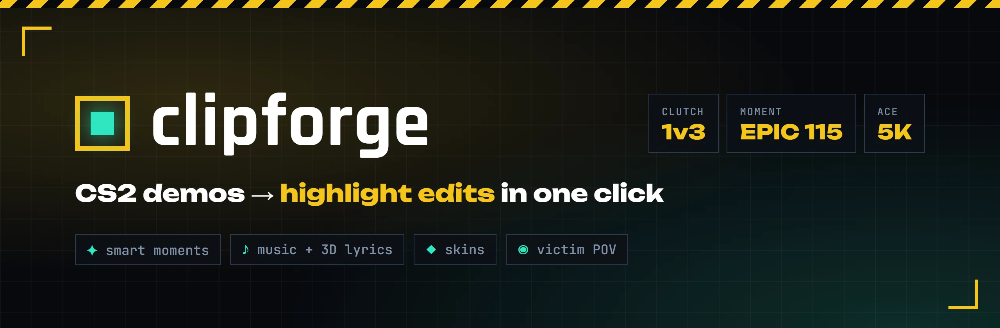
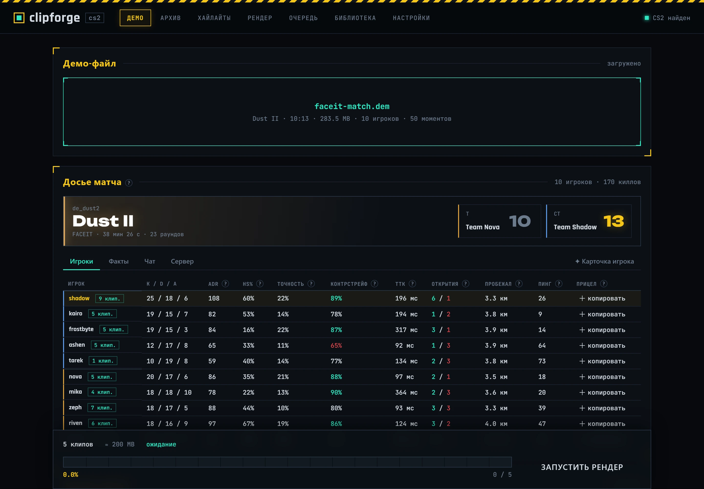
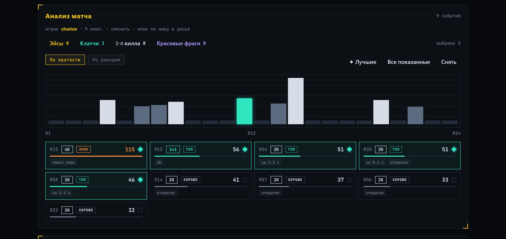
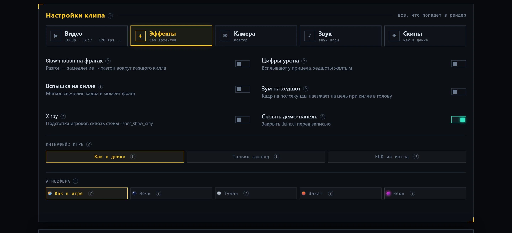
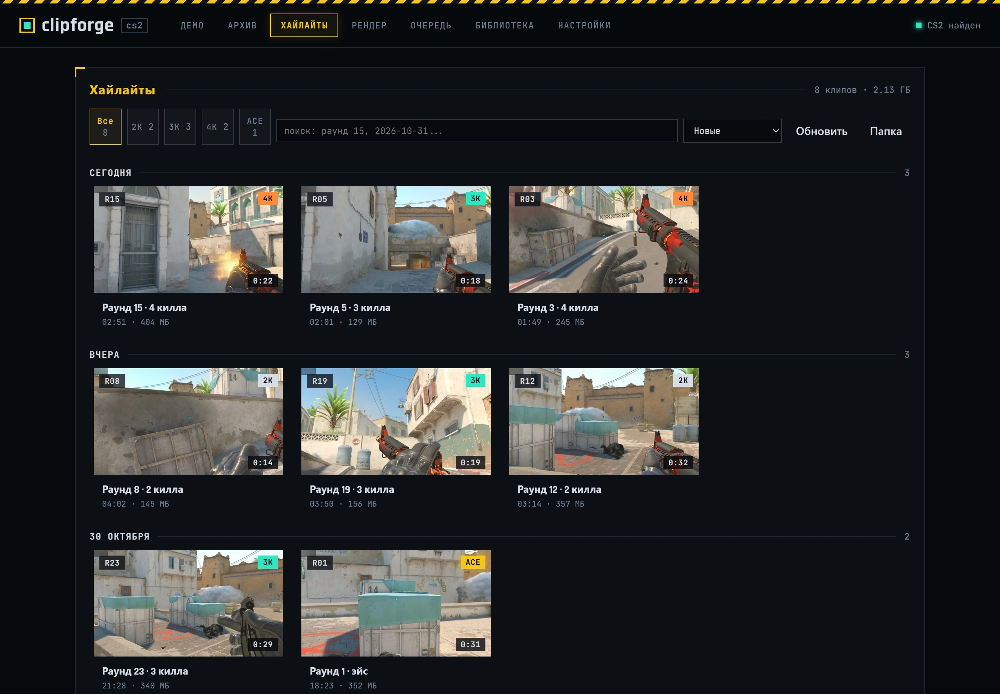
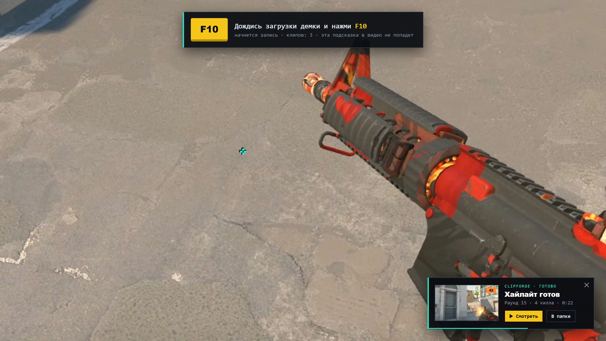
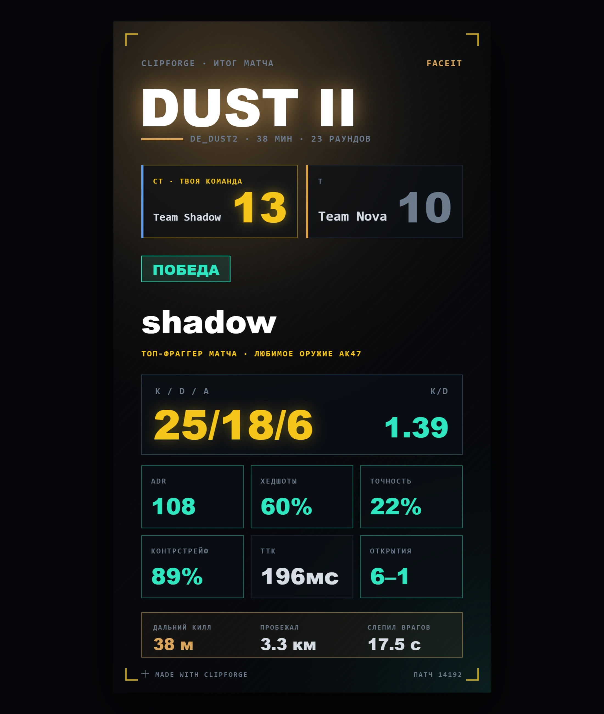
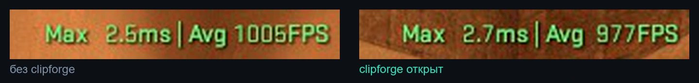

<div align="center">



[English](README.md) · **Русский**

[](#что-нужно)
[](https://tauri.app)
[](https://react.dev)
[](https://www.rust-lang.org)
[](LICENSE)
[](https://github.com/BeanDx/clipforge/stargazers)

**Кидаешь демку CS2, получаешь готовые эдиты для TikTok и YouTube.**<br>
clipforge сам находит лучшие моменты, записывает их в игре через HLAE и добавляет slow-mo, музыку с 3D-текстом песни, скины и повтор глазами убитого. Видеоредактор не нужен.

</div>

<br>

<p align="center"></p>

## Возможности

### ✦ Умная выборка моментов
Каждый раунд каждого игрока получает баллы и метки, как в сервисах хайлайтов, только по всем данным из демки.

- **Мультикиллы** 2K, 3K, 4K, эйс, с бонусом за скорость («3K за 2.1 с»)
- **Настоящие клатчи 1vN**: когда ты остался последним, против скольких, и выиграла ли команда раунд
- **Красивые фраги**: сквозь стену, через смок, no-scope, в прыжке, ослепленным, ножом, зевсом, дальше 40 м, коллатералы
- **Ситуация**: открытие раунда, эко, пистолетка, решающий раунд, ниндзя-дефьюз
- Уровни от **Хорошо** до **Легенда**, сортировка по крутости, лучшие выбираются сами

<p align="center"></p>

### 🎬 Эффекты как в эдитах
- **Slow-motion** вокруг киллов с плавным разгоном. Звук замедляется через Rubber Band, выстрелы остаются четкими
- **Вспышка на килле** (розовая, белая или золотая) и **зум на хедшот**
- **Зум и тряска в такт** по бочке и басу трека
- **Атмосфера**: ночь, туман, закат, неон. Цветокоррекция плюс настоящий туман и небо в игре через HLAE
- **Цифры урона** у прицела, полноценный **HUD матча** по данным демки или чистый кадр только с килфидом
- Смешивание кадров, любое разрешение и пропорции, **растянутый 4:3**, кодирование на видеокарте (NVENC, AMF, Quick Sync)

<p align="center"></p>

### ♪ Музыка и текст песни прямо на карте
- Подкладываешь свой трек, синхронизированный текст подтягивается с LRCLIB. Можно вставить свой и разметить строки пробелом
- Текст висит в 3D внутри карты и подсвечивается как в караоке
- Припев попадает точно на последний килл вместе с плавным замедлением

### ◉ Кинокамера
- **Повтор от лица убитого**: после клипа каждый фраг показывается глазами того, кого ты убил
- **Облет камерой** вокруг игрока после последнего килла (экспериментально)

### ◆ Скины
Меняй скины оружия, модель и раскраску ножа, перчатки. clipforge записывает измененную копию демки, поэтому инвентарь и файлы игры никто не трогает.

### 📊 Досье матча
То, чего не видно в таблице счета: коды прицелов (копируются в один клик), точность, контрстрейф, время до убийства, открытия, сколько пробежал, чат и настройки сервера. Уровни FACEIT по желанию, со своим ключом API.

### 🖼 Галерея хайлайтов, карточка игрока и не только
- Галерея готовых клипов с превью, сортировкой, фильтрами и встроенным плеером
- **Карточка игрока 1080×1920** для сторис или Discord, копируется в буфер одной кнопкой
- Шторка **«до / после»**: сырая запись из демки и готовый клип в один и тот же момент
- Подсказка поверх CS2: какую клавишу нажать и как идет запись. В видео она не попадает
- Уведомление, когда хайлайт готов
- Интерфейс на русском и английском, переключается на лету

<table>
  <tr>
    <td width="50%"></td>
    <td width="50%"></td>
  </tr>
  <tr>
    <td align="center"><sub>Галерея хайлайтов</sub></td>
    <td align="center"><sub>Подсказка поверх игры и уведомление «Хайлайт готов»</sub></td>
  </tr>
</table>

<p align="center"></p>

## Как это работает

```
 .dem ──► demoparser2 ──► моменты + статистика ──► выбираешь клипы
                                                        │
       скины? ──► source2-demo переписывает копию ◄─────┘
                                                        │
 CS2 + HLAE проигрывает демку, жмешь F10 ──► кадры + звук
                                                        │
 ffmpeg: блюр, slow-mo, HUD, текст, вспышка, зум, музыка ──► .mp4
```

1. Демка разбирается через **demoparser2**: киллы, урон, позиции, раунды, экипировка.
2. Моменты получают баллы и показываются на шкале раундов.
3. Если менялись скины, копия демки переписывается через **source2-demo**.
4. **CS2 запускается через HLAE** с демкой. Ее можно сначала посмотреть, запись начинается по клавише (по умолчанию F10).
5. HLAE пишет кадры прямо из движка игры, потом **ffmpeg** собирает клип со всеми эффектами.

## Что нужно

**Чтобы пользоваться:**
- Windows 10 или 11
- [Counter-Strike 2](https://store.steampowered.com/app/730) из Steam
- [HLAE](https://www.advancedfx.org) (Half-Life Advanced Effects). Для кодирования берется его ffmpeg, больше ничего ставить не нужно

**Чтобы собрать из исходников, еще:**
- [Node.js](https://nodejs.org) 18 или новее
- [Rust](https://rustup.rs) stable и инструменты сборки C++ из Visual Studio
- WebView2 (уже есть в Windows 10/11)

## Как запустить

**Установщик:** скачай `clipforge_x.y.z_x64-setup.exe` в [Releases](https://github.com/BeanDx/clipforge/releases) и запусти. Внутри уже есть все нужное, включая свою копию Node.js для разбора демок.

**Из исходников:**

```bash
git clone https://github.com/BeanDx/clipforge.git
cd clipforge
npm install
npx tauri dev
```

Собрать установщик:

```bash
npx tauri build
```

Установщик появится в `src-tauri/target/release/bundle/`.

**Первый запуск:**
1. Открой **Настройки** и проверь пути к `HLAE.exe` и `cs2.exe` (обычно находятся сами) и папку для клипов.
2. Перетащи `.dem` на вкладку **Демо**.
3. Выбери игрока в **Досье матча**, отметь моменты, настрой **Настройки клипа**.
4. Нажми **Запустить рендер**, дождись загрузки демки в CS2 и нажми **F10**.
5. После F10 можно переключиться через Alt+Tab и заниматься своими делами, запись идет дальше. Когда все будет готово, придет уведомление, а клипы появятся во вкладке **Хайлайты**.

## Вопросы

<details>
<summary><b>Меня не забанит VAC?</b></summary>
<br>
CS2 запускается через HLAE с параметром <code>-insecure</code>: в этой сессии VAC выключен и на защищенные серверы с ней не зайти. clipforge только проигрывает демки у тебя на компьютере. После рендера игра закрывается сама. Перед матчмейкингом просто запусти CS2 как обычно.
</details>

<details>
<summary><b>Падает ли FPS, если держать программу открытой во время игры?</b></summary>
<br>
Почти нет. Одно и то же место на карте, счетчик FPS в CS2, слева clipforge закрыт, справа открыт:
<br><br>

<br>
1005 и 977 FPS в среднем, около 3%, это в пределах обычного разброса между замерами. Пока ты в игре, clipforge ставит свои анимации на паузу и берет около 0% процессора и ~270 МБ памяти.
</details>

<details>
<summary><b>Нужен ли ключ FACEIT API?</b></summary>
<br>
Нет. Он нужен только для уровней и эло FACEIT в «Досье матча». Все остальное работает без него.
</details>

<details>
<summary><b>Кто-то увидит измененные скины?</b></summary>
<br>
Нет. clipforge записывает измененную копию демки и пишет видео с нее. Инвентарь, игра и исходная демка остаются как были.
</details>

<details>
<summary><b>Какие демки подходят?</b></summary>
<br>
Демки CS2 с FACEIT, из матчмейкинга Valve и Premier, а также SourceTV-демки с community-серверов.
</details>

## На чем сделано

| | |
|---|---|
| [Tauri 2](https://tauri.app) | десктопная оболочка, бэкенд на Rust |
| [React 19](https://react.dev) + [Vite](https://vite.dev) | интерфейс |
| [demoparser2](https://github.com/LaihoE/demoparser) | разбор демок CS2 |
| [source2-demo](https://crates.io/crates/source2-demo) | перезапись демок для скинов (доработанная копия лежит в `src-tauri/vendor`) |
| [HLAE](https://github.com/advancedfx/advancedfx) | запись в игре, пути камеры, небо и цвета |
| [ffmpeg](https://ffmpeg.org) | обработка и кодирование видео |
| [LRCLIB](https://lrclib.net) | синхронизированные тексты песен |
| [CSGO-API](https://github.com/ByMykel/CSGO-API) | каталог и картинки скинов |
| [FACEIT Data API](https://developers.faceit.com) | уровни игроков, по желанию |

## Планы

- [x] Готовый установщик
- [ ] Автообновление
- [ ] Мастер первого запуска
- [ ] Пакетный рендер нескольких демок
- [ ] Метки киллов прямо в видео (WALLBANG, 1v3 CLUTCH)
- [ ] Обрезка и экспорт под TikTok и Discord
- [ ] Личные рекорды и достижения по всем демкам

Идеи и баги пиши в [Issues](https://github.com/BeanDx/clipforge/issues).

## Лицензия

[MIT](LICENSE) © BeanDx

<sub>clipforge не связан с Valve Corporation и FACEIT и не одобрен ими. Counter-Strike является товарным знаком Valve Corporation.</sub>
